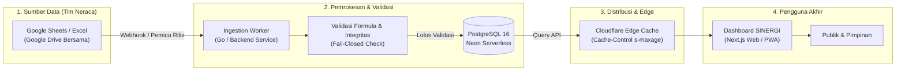

# SINERGI (`nerasync-dashboard`)
### Sistem Informasi Neraca Terintegrasi

[](#status-proyek-saat-ini)
[](#tumpukan-teknologi-terencana)
[](#tata-kelola--lisensi)

---

> [!IMPORTANT]
> **PEMBERITAHUAN STATUS PROYEK (README SEMENTARA):**  
> Repositori ini saat ini berada pada **Tahap Inisiasi Proyek dan Perancangan Spesifikasi Teknis (*Technical Design & Specification Baseline*)**. Seluruh dokumen acuan arsitektur, model data, desain visual, dan alur kerja telah selesai dirumuskan.  
> **Implementasi kode sumber aplikasi (*source code*) belum dimulai.** Fitur-fitur yang tercantum di bawah ini merupakan rancangan ruang lingkup teknis yang akan diimplementasikan pada tahap pengembangan berikutnya.

---

## Daftar Isi

1. [Ringkasan Proyek](#1-ringkasan-proyek)
2. [Status Proyek Saat Ini](#2-status-proyek-saat-ini)
3. [Rancangan Ruang Lingkup Fitur (Rilis 1.0)](#3-rancangan-ruang-lingkup-fitur-rilis-10)
4. [Tumpukan Teknologi Terencana](#4-tumpukan-teknologi-terencana)
5. [Gambaran Arsitektur Sistem](#5-gambaran-arsitektur-sistem)
6. [Struktur Repositori](#6-struktur-repositori)
7. [Prasyarat Lingkungan Pengembangan](#7-prasyarat-lingkungan-pengembangan)
8. [Panduan Kolaborasi & Keamanan Git](#8-panduan-kolaborasi--keamanan-git)
9. [Tata Kelola & Pemangku Kepentingan](#9-tata-kelola--pemangku-kepentingan)

---

## 1. Ringkasan Proyek

**SINERGI** (*Sistem Informasi Neraca Terintegrasi*) adalah platform web dashboard analitik yang dirancang untuk mendiseminasikan indikator statistik **Neraca Wilayah** (khususnya Produk Domestik Regional Bruto / PDRB Lapangan Usaha dan PDRB Pengeluaran) secara interaktif, cepat, dan mudah dipahami oleh publik, pemangku kebijakan, serta akademisi.

### Masalah Utama yang Diselesaikan:
- **Diseminasi Ramah Publik:** Mengubah tabel data statistik neraca yang rumit dan padat menjadi visualisasi interaktif (treemap, waterfall, grafik kombinasi) disertai glosarium istilah awam.
- **Efisiensi Rilis (*Zero Web-Admin*):** Tim Neraca tidak perlu menginput data secara manual melalui antarmuka web. Data bersumber langsung dari spreadsheet kerja (Google Sheets / Excel di Google Drive bersama) yang dipublikasikan secara otomatis melalui mekanisme validasi dan *snapshotting*.
- **Efisiensi Biaya Infrastruktur:** Dirancang beroperasi optimal di atas infrastruktur cloud modern berbasis *edge caching* dan arsitektur *free tier* yang tangguh terhadap lonjakan trafik saat hari rilis data resmi.

---

## 2. Status Proyek Saat Ini

| Dimensi | Status | Keterangan |
|---|---|---|
| **Tahapan Proyek** | **Inisiasi & Desain Teknis (Selesai)** | Dokumen spesifikasi kebutuhan, arsitektur, skema DB, dan desain sistem telah rampung. |
| **Implementasi Kode** | **Belum Dimulai (*Pending*)** | Kode frontend (`apps/web`), backend (`apps/api`), dan skrip migrasi database sedang dipersiapkan. |
| **Dokumentasi Internal** | **Tersedia (Lokal)** | Berkas spesifikasi teknis lengkap tersimpan di folder lokal `docs/` (dikecualikan dari Git publik via `.gitignore`). |
| **Repositori Git** | **Inisialisasi Dasar** | Branch `main` telah dikonfigurasi dengan aturan pengabaian berkas rahasia (`.gitignore`). |

---

## 3. Rancangan Ruang Lingkup Fitur (Rilis 1.0)

Semua poin di bawah ini merupakan fitur yang **telah dispesifikasikan dalam rancangan teknis dan akan diimplementasikan bertahap**:

### A. Dashboard Publik (Tanpa Autentikasi / *Zero-Login*)
- **Ringkasan KPI Makro:** Kartu indikator PDRB nominal (ADHB), PDRB riil (ADHK), laju pertumbuhan (YoY, QtQ, CtC), dan sektor penyumbang pertumbuhan ekonomi utama.
- **Visualisasi Sektoral (PDRB Lapangan Usaha):** Grafik interaktif struktur ekonomi 17 sektor (treemap/bar chart) dan penelusuran hierarki (*drill-down* sub-kategori).
- **Visualisasi Komponen Pengeluaran (PDRB Pengeluaran):** Analisis konsumsi rumah tangga, PMTB (investasi), konsumsi pemerintah, dan net ekspor.
- **Penjelajah Data (*Data Explorer*):** Tabel dinamis data *time-series* kuartalan dan tahunan dengan fitur filter periode, perbandingan antar-waktu, dan pengurutan nilai.
- **Unduh Data & Visualisasi:** Ekspor data ke format CSV/Excel dan tangkapan grafik beresolusi tinggi (PNG/SVG).
- **Glosarium & Metodologi:** Penjelasan konsep indikator neraca dengan bahasa yang ramah bagi masyarakat umum.

### B. Otomasi & Sinkronisasi Data (*Zero Web-Admin*)
- **Integrasi Spreadsheet:** Penarikan data otomatis dari Google Sheets (melalui Google Sheets API v4) atau Excel `.xlsx` di Google Drive bersama.
- **Validasi Integritas Data:** Pengecekan otomatis kesesuaian formula neraca (misal: total ADHB = jumlah komponen, laju pertumbuhan = perhitungan indeks) sebelum data disajikan ke publik.
- **Sistem Snapshot & Versi Data:** Penyimpanan riwayat versi data neraca untuk mendukung transparansi angka sementara vs angka sangat sementara / final.

---

## 4. Tumpukan Teknologi Terencana

Arsitektur aplikasi dirancang modular menggunakan teknologi modern:

| Lapisan Sistem | Teknologi yang Direncanakan | Peran & Alasan Pemilihan |
|---|---|---|
| **Frontend Framework** | **Next.js (App Router, TypeScript)** | Server-side rendering (SSR), visualisasi data, performa tinggi, dan SEO-ready. |
| **Komponen & Desain** | **Tailwind CSS + shadcn/ui** | Desain sistem standar BPS, aksesibilitas WCAG 2.1 AA, dan responsif lintas perangkat. |
| **Visualisasi Data** | **Apache ECharts** | Rendering visual grafik, treemap, dan bar chart yang interaktif serta ramah disabilitas warna. |
| **Backend & Ingestion** | **Go (Chi v5)** atau **Cloudflare Workers** | Layanan penarikan data, parser Excel/Spreadsheet, validasi formula, dan webhook sinkronisasi. |
| **Basis Data Utama** | **PostgreSQL 16 (Neon Serverless)** | Penyimpanan data relasional dan `JSONB` untuk fleksibilitas struktur tabel neraca. |
| **Edge & CDN** | **Cloudflare** | Proteksi DNS, SSL otomatis, dan *edge caching* untuk menyerap lonjakan pengunjung tanpa membebani database. |
| **CI/CD & DevOps** | **GitHub Actions** | Otomasi pengujian (*lint*, *type check*, *security scan*) dan deployment otomatis. |

---

## 5. Gambaran Arsitektur Sistem

Alur kerja data dari sumber spreadsheet hingga diterima masyarakat umum dirancang sebagai berikut:



---

## 6. Struktur Repositori

Struktur target direktori proyek yang akan dibangun pada fase implementasi:

```text
nerasync-dashboard/
├── .gitignore               # Konfigurasi pengabaian berkas rahasia & lokal
├── README.md                # Dokumentasi utama proyek
├── AGENTS.md                # Panduan instruksi untuk AI Agent pengembang
│
├── docs/                    # [LOKAL - Ignored] Spesifikasi teknis lengkap (PRD, Arsitektur, dll.)
│
├── apps/                    # [Rencana Implementasi]
│   ├── web/                 # Aplikasi Frontend Next.js (Dashboard Publik)
│   └── api/                 # Layanan Backend & Ingestion Worker (Go)
│
├── packages/                # [Rencana Implementasi]
│   ├── schema/              # Kontrak data bersama & skema validasi (Zod / OpenAPI)
│   └── ui/                  # Komponen antarmuka yang dapat digunakan ulang
│
└── config/                  # [Rencana Implementasi] Config-as-Code (Mapping skema spreadsheet)
```

---

## 7. Prasyarat Lingkungan Pengembangan

Ketika tahap implementasi kode dimulai, pengembang lokal memerlukan prasyarat berikut:

- **Node.js:** Versi `≥ 20.x LTS`
- **Package Manager:** `pnpm` (versi `≥ 9.x`)
- **Go:** Versi `≥ 1.22` (untuk pengembangan backend/ingestion worker)
- **Git:** Versi `≥ 2.40`
- **Kredensial Lokal:** Berkas `.env.local` (akan disediakan melalui template `.env.example` saat kode dirilis).

---

## 8. Panduan Kolaborasi & Keamanan Git

1. **Strategi Branching:**  
   Menggunakan model **GitHub Flow** (*Short-Lived Branches*). Seluruh pengerjaan fitur baru dilakukan di branch terpisah (`feat/...`, `fix/...`) dan digabungkan ke `main` melalui *Pull Request*.
2. **Standar Pesan Commit:**  
   Mengikuti kaidah **Conventional Commits** (`feat:`, `fix:`, `docs:`, `refactor:`, `test:`, `chore:`).
3. **Kebijakan Keamanan Tanpa Rahasia (*Zero Secret Policy*):**  
   Dilarang keras memasukkan berkas konfigurasi lokal berisi token (`.env*`), kunci privat (`*.pem`), kredensial Service Account (`*.json`), atau tautan berkas asli spreadsheet (`link.md`) ke dalam Git. Berkas-berkas ini telah dilindungi melalui konfigurasi [.gitignore](file:///.gitignore).

---

## 9. Tata Kelola & Pemangku Kepentingan

- **Institusi Penyelenggara:** Badan Pusat Statistik (BPS)
- **Unit Penanggung Jawab:** Tim Neraca Wilayah & Analisis Statistik bersama Pranata Komputer / Tim IT.
- **Model Lisensi:** *Proprietary / Hak Cipta Dilindungi* — untuk kepentingan internal dan diseminasi publik resmi BPS.

---
*Catatan: Dokumen ini akan diperbarui secara berkala seiring dimulainya tahap implementasi dan rilis modul kode pertama.*
